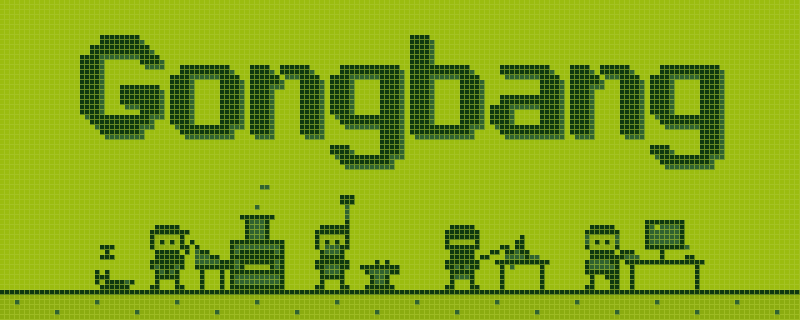

<p align="center">
  
</p>

<h1 align="center">
    dev-gongbang
</h1>

<p align="center">
    A collection of Claude Code skills for development work.
</p>

<p align="center"><a href="./README.md">한국어</a> · <b>English</b></p>

These Claude Code skills help you frame requests, build prompts and skills, write docs, and set and check code rules. Skills that carry a planning document or request through the development stages to a PR are being built in `gongbang-dev`. You install them as plugins, and you can copy a skill and edit it to fit your situation. The skill files are written in Korean.

**Contents**: [Installation](#installation) · [Skills](#skills) · [In-progress skills](#in-progress-skills) · [Mods](#mods) · [Choosing a skill](#choosing-a-skill) · [Customize](#customize) · [Contributing](#contributing) · [All docs](docs/en/README.md)

## Installation

Add the marketplace and install the `gongbang` plugin.

```bash
claude plugin marketplace add develeep/dev-gongbang
claude plugin install gongbang@dev-gongbang
```

Run an installed skill with `/gongbang:<skill-name>`. Example: `/gongbang:prompt-builder`

To also use in-progress skills, install `gongbang-dev` as well.

```bash
claude plugin install gongbang-dev@dev-gongbang
```

### Other agents

OMP (oh-my-pi) and Codex install the skills from the same marketplace. `gongbang-mods` is Claude Code only and does not work in either.

```bash
# OMP
omp plugin marketplace add develeep/dev-gongbang
omp plugin install gongbang@dev-gongbang

# Codex: add the marketplace, install gongbang from the /plugins screen in Codex CLI, then start a new session
codex plugin marketplace add develeep/dev-gongbang
```

In Codex, run a skill with `$<skill-name>`. User-invoked skills ship an `agents/openai.yaml` so Codex does not invoke them on its own.

To install the OMP agents for cross-review and brief cold reads, the delegation rules, and the protected path extension, see [omp multi-agent setup](docs/en/omp-orchestration.md).

### Updating

The plugin updates only when `version` in `plugin.json` changes. See [Releases](https://github.com/develeep/dev-gongbang/releases) for what changed in each version. Update the marketplace, update the plugin, then restart Claude Code.

```bash
claude plugin marketplace update dev-gongbang
claude plugin update gongbang@dev-gongbang
```

If you installed `gongbang-dev`, also run `claude plugin update gongbang-dev@dev-gongbang`. `gongbang-mods` has its own version; how to update it is in the [Mods doc](docs/en/mods.md#turning-it-off-and-updating).

## Skills

Skills fall into two groups by invocation type.

- **User-invoked**: Runs only when you type `/gongbang:<skill-name>`.
- **Model-invoked**: You can type the name, and Claude can also pick and run the skill on its own when a request matches the skill description.

Click a skill name to open its usage page. Click `SKILL.md` to open the skill source. Every page is listed in [All docs](docs/en/README.md).

### User-invoked

- [prompt-builder](docs/en/skills/prompt-builder.md): Designs system and agent prompts, CLAUDE.md, and SKILL.md through an interview that follows the Claude and GPT per-model guides, or revises and reviews an existing draft. `/gongbang:prompt-builder [draft path or description of the prompt to build]` · [SKILL.md](skills/productivity/prompt-builder/SKILL.md)
- [building-skills](docs/en/skills/building-skills.md): Following Claude's official skill best practices and the Agent Skills spec, completes a skill from a SKILL.md draft or from material such as conversation logs, runbooks, or code, then repeats static checks, test runs, human review, and fixes. `/gongbang:building-skills [skill folder path, SKILL.md draft, or description of the skill to build]` · [SKILL.md](skills/productivity/building-skills/SKILL.md)
- [write-docs](docs/en/skills/write-docs.md): Sets field, audience, purpose, tone, and material through questions, then drafts the text or revises a draft or existing document you bring. Work messages lead with the conclusion, and technical documents follow the document types and principles of the Toss technical writing guide. `/gongbang:write-docs [request for the text to write or revise]` · [SKILL.md](skills/productivity/write-docs/SKILL.md)
- [set-guidelines](docs/en/skills/set-guidelines.md): Picks guides and tools from awesome-guidelines that fit the repo's languages and frameworks, then writes the ones you choose: `.claude/rules/` rule files, CLAUDE.md/AGENTS.md, and linter/formatter config. `/gongbang:set-guidelines` · [SKILL.md](skills/engineering/set-guidelines/SKILL.md)

### Model-invoked

- [framing-problems](docs/en/skills/framing-problems.md): Does not act right away. First confirms with you a framing record of intent, cause, and constraints, then works from that record. Runs only when you ask for framing or a prompt or another skill tells it to. `/gongbang:framing-problems [request to frame]` · [SKILL.md](skills/productivity/framing-problems/SKILL.md)
- [check-guidelines](docs/en/skills/check-guidelines.md): Checks code in the chosen scope against rule files, CLAUDE.md/AGENTS.md, and linter/formatter config, reports by rule, fixes the violations you choose, then checks again. `/gongbang:check-guidelines [all | diff | branch | path]` · [SKILL.md](skills/engineering/check-guidelines/SKILL.md)

## In-progress skills

Available when you install `gongbang-dev`. Their behavior changes often.

### User-invoked

- [run-flow](docs/en/skills/run-flow.md): Takes a planning document, a request, or a brief and loads the stage skills in order, from organizing requirements to opening a PR. You only answer the confirmations and questions each stage skill asks. Run it with no argument to continue the flow in progress, or with `status` to list unfinished flows. `/gongbang:run-flow [planning doc path/link | request | brief path/issue number | state file | status]` · [SKILL.md](skills/in-progress/run-flow/SKILL.md)

### Model-invoked

- [set-brief](docs/en/skills/set-brief.md): Turns a framing record or session result into a brief that a worker with no context can read alone and produce the same result from, and saves it as a GitHub issue or a `docs/context/` document. Runs only when you ask or another skill such as run-flow tells it to. `/gongbang:set-brief [summary of the work to record]` · [SKILL.md](skills/in-progress/set-brief/SKILL.md)
- [set-ticket](docs/en/skills/set-ticket.md): When a brief saved by set-brief is too large to work on in one go, splits it into tickets that can each be verified on their own, saves them as GitHub sub-issues or docs files, and links them to the brief. Runs only when you ask or another skill such as run-flow tells it to. `/gongbang:set-ticket [brief issue number/URL or docs path]` · [SKILL.md](skills/in-progress/set-ticket/SKILL.md)
- [run-ticket](docs/en/skills/run-ticket.md): Takes the brief and ticket documents, has the current session implement and review one ticket itself, then updates the ticket status and the brief checkbox. It does not commit when it runs a ticket itself. Several tickets run in order, and run in parallel on workers only when you name a worker tool procedure or one is registered in the repo or agent rules. Runs only when you ask or another skill such as run-flow tells it to. `/gongbang:run-ticket [ticket/brief path, issue number/URL] [range, for multiple tickets]` · [SKILL.md](skills/in-progress/run-ticket/SKILL.md)
- [analyzing-requirements](docs/en/skills/analyzing-requirements.md): Reads a planning document received as a link such as SharePoint or OneDrive, or as a PDF/PPT/MD file, and organizes requirements and development scope by service and development area into a Markdown document. It does not fill in what the document leaves out, and asks about anything ambiguous. `/gongbang:analyzing-requirements [planning document link or file path]` · [SKILL.md](skills/in-progress/analyzing-requirements/SKILL.md)

## Mods

`gongbang-mods` is a bundle of mods that restyle the Claude Code terminal and block writes to run-flow protected paths. Install it separately from the skills plugin.

```bash
claude plugin install gongbang-mods@dev-gongbang
```

- [gongbang-mods](docs/en/mods.md): Folds tool calls to one line, splits your messages and replies into cards, and shows the session goal and context usage in a side pane. `/session-pane` opens that pane, and `/where` recaps the session so far in a few lines. During a run-flow flow it blocks write tools from editing tests on the protected list. [code](mods/gongbang-mods/hooks/register.tsx)

Outside mods that pair well are listed in the [Mods doc](docs/en/mods.md#outside-mods-that-pair-well). A [status line script](docs/en/mods.md#status-line) showing the model, branch and plan usage is installed separately. [code](extras/statusline/statusline.py)

To set up the same mod environment (gongbang-mods, outside mods, status line) on another computer in one go, run `extras/setup.sh`. [details](docs/en/mods.md#same-setup-on-another-computer)

## Choosing a skill

| Situation | Skill |
|---|---|
| The request is vague and starting right away feels risky | framing-problems |
| You are building or revising a system prompt, agent prompt, or CLAUDE.md | prompt-builder |
| You are building a skill and refining it by actually running it | building-skills |
| You are writing or revising a README, guide, or explanation | write-docs |
| The repo has no coding rules or linter/formatter config | set-guidelines |
| Before a commit or PR, you want to see whether the changes follow team rules | check-guidelines |
| You are turning a planning document into development scope and requirements | analyzing-requirements |
| You are handing work that does not fit in one session to another session or agent | set-brief → set-ticket → run-ticket |
| You want to go from a planning document or request to a PR without running each stage's skill yourself | run-flow |

Skills chain together as follows.

- **Building a prompt**: Frame the task first with `/gongbang:framing-problems`, then pass the confirmed framing record to `/gongbang:prompt-builder` as a draft. You can make an agent prompt that talks to people, or a reusable template, call framing-problems every time it runs.
- **Building a skill**: Create a SKILL.md draft with `/gongbang:prompt-builder`, then pass the result to `/gongbang:building-skills` to test and refine it.
- **Code rules**: Create rules with `/gongbang:set-guidelines`, then check code with `/gongbang:check-guidelines`.
- **Handing off large work**: Save the result framed with framing-problems using `/gongbang:set-brief`. If it is large, split it with `/gongbang:set-ticket`, then run the tickets with `/gongbang:run-ticket`. Give a range such as "all remaining tickets" to run several tickets in order. If a worker tool procedure is registered in the repo or agent rules (for example, [Orca](docs/en/orca-orchestration.md) or [Paseo](docs/en/paseo-orchestration.md)), they run in parallel on workers.
- **Handing over the whole run**: Run `/gongbang:run-flow <planning document or request>`. It starts from analyzing-requirements for a planning document or from framing-problems for a request, goes through the flow above, and continues to the stage where you choose whether to open a PR. It opens the PR only if you choose to at that stage. To continue a stopped run, run `/gongbang:run-flow` again with no argument. To list unfinished runs, run `/gongbang:run-flow status`.

## Customize

How to copy and edit a skill, which files to edit for each skill, and how to test an edited skill are in the [customization guide](docs/en/customization.md).

## Contributing

For issues, PRs, and commit rules, see the [contributing guide](CONTRIBUTING.en.md). Everyone who takes part in this project follows the [code of conduct](CODE_OF_CONDUCT.en.md). Report security problems privately as described in the [security policy](SECURITY.en.md).

Rules to follow when adding or moving a skill are in [AGENTS.md](AGENTS.md). After making changes, run `scripts/check.py` and make it pass. It requires PyYAML and the Claude Code CLI.

Run skill evals with these commands. Evals call the models for real.

```bash
claude plugin eval . --scaffold --allow-tools Bash Write Edit WebSearch WebFetch --no-publish
claude plugin eval . --eval-dir evals-trigger --ablation none --no-publish
```

## License

[MIT](LICENSE)
