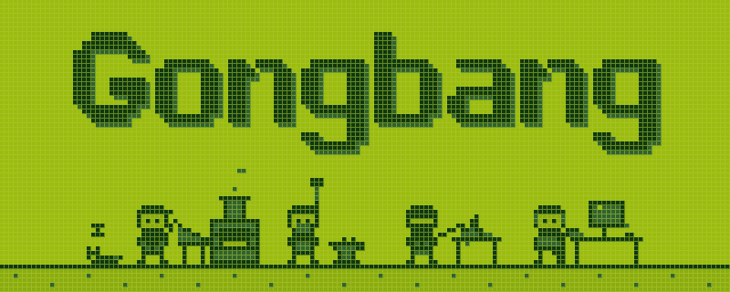

<p align="center">
  
</p>

<h1 align="center">
    dev-gongbang
</h1>

<p align="center">
    A collection of Claude Code skills for development work.
</p>

<p align="center"><a href="./README.md">한국어</a> · <b>English</b></p>

These Claude Code skills help you frame requests, build prompts and skills, write docs, and set and check code rules. You install them as one plugin, and you can copy a skill and edit it to fit your situation. The skill files are written in Korean.

## Installation

Add the marketplace and install the `gongbang` plugin.

```bash
claude plugin marketplace add develeep/dev-gongbang
claude plugin install gongbang@dev-gongbang
```

Run an installed skill with `/gongbang:<skill-name>`. Example: `/gongbang:prompt-builder`

To also use in-progress skills, install `gongbang-dev` as well.

```bash
claude plugin install gongbang-dev@dev-gongbang
```

### Updating

The plugin updates only when `version` in `plugin.json` changes. Update the marketplace, update the plugin, then restart Claude Code.

```bash
claude plugin marketplace update dev-gongbang
claude plugin update gongbang@dev-gongbang
```

## Skills

Skills fall into two groups by invocation type.

- **User-invoked**: Runs only when you type `/gongbang:<skill-name>`.
- **Model-invoked**: You can type the name, and Claude can also pick and run the skill on its own when a request matches the skill description.

Click a skill name to open its usage page. Click `SKILL.md` to open the skill source.

### User-invoked

- [prompt-builder](docs/en/skills/prompt-builder.md): Designs system prompts, CLAUDE.md, and SKILL.md through an interview that follows per-model guides, or revises a draft. `/gongbang:prompt-builder [draft path or description]` · [SKILL.md](skills/productivity/prompt-builder/SKILL.md)
- [building-skills](docs/en/skills/building-skills.md): Completes a skill from a SKILL.md draft or from material such as conversation logs, runbooks, or code, then repeats static checks, test runs, human review, and fixes. `/gongbang:building-skills [skill folder path, SKILL.md draft, or description of the skill to build]` · [SKILL.md](skills/productivity/building-skills/SKILL.md)
- [write-docs](docs/en/skills/write-docs.md): Sets field, audience, purpose, tone, and material through questions, then drafts the text or revises a draft or existing document you bring. `/gongbang:write-docs [request for the text to write or revise]` · [SKILL.md](skills/productivity/write-docs/SKILL.md)
- [set-guidelines](docs/en/skills/set-guidelines.md): Picks guides and tools that fit the repo from awesome-guidelines, then writes the ones you choose: `.claude/rules/` rule files, CLAUDE.md/AGENTS.md, and linter/formatter config. `/gongbang:set-guidelines` · [SKILL.md](skills/engineering/set-guidelines/SKILL.md)

### Model-invoked

- [framing-problems](docs/en/skills/framing-problems.md): Does not act right away. First confirms with you a framing record of intent, cause, and constraints, then works. Runs only when explicitly requested. `/gongbang:framing-problems [request]` · [SKILL.md](skills/productivity/framing-problems/SKILL.md)
- [check-guidelines](docs/en/skills/check-guidelines.md): Checks code in the chosen scope against rule files, CLAUDE.md/AGENTS.md, and linter/formatter config, reports by rule, fixes the violations you choose, then checks again. `/gongbang:check-guidelines [all | diff | branch | path]` · [SKILL.md](skills/engineering/check-guidelines/SKILL.md)

## In-progress skills

Available when you install `gongbang-dev`. Their behavior changes often.

### User-invoked

- [set-brief](docs/en/skills/set-brief.md): Turns a framing record or session result into a brief that a worker with no context can pick up, and saves it as a GitHub issue or a `docs/context/` document. `/gongbang:set-brief [summary of the work to record]` · [SKILL.md](skills/in-progress/set-brief/SKILL.md)
- [set-ticket](docs/en/skills/set-ticket.md): Splits a large brief into tickets that can each be verified on their own, saves them as GitHub sub-issues or docs files, and links them to the brief. `/gongbang:set-ticket [brief issue number/URL or docs path]` · [SKILL.md](skills/in-progress/set-ticket/SKILL.md)
- [run-ticket](docs/en/skills/run-ticket.md): Implements and reviews one ticket in a new session, then updates the ticket status and the brief checkbox. Does not commit. `/gongbang:run-ticket [ticket/brief path, issue number/URL] [range, for multiple tickets]` · [SKILL.md](skills/in-progress/run-ticket/SKILL.md)

### Model-invoked

- [analyzing-requirements](docs/en/skills/analyzing-requirements.md): Reads a planning document received as a link or as PDF/PPT/MD, and organizes requirements and development scope by service and development area into a Markdown document. `/gongbang:analyzing-requirements [planning document link or file path]` · [SKILL.md](skills/in-progress/analyzing-requirements/SKILL.md)

## Choosing a skill

| Situation | Skill |
|---|---|
| The request is vague and starting right away feels risky | framing-problems |
| You are building or revising a system prompt, agent prompt, or CLAUDE.md | prompt-builder |
| You are building a skill and refining it by actually running it | building-skills |
| You are writing or revising a README, guide, or explanation | write-docs |
| The repo has no coding rules or linter/formatter config | set-guidelines |
| Before a commit or PR, you want to see whether the changes follow team rules | check-guidelines |
| You are turning a planning document into development scope and requirements | analyzing-requirements |
| You are handing work that does not fit in one session to another session or agent | set-brief → set-ticket → run-ticket |

Skills chain together as follows.

- **Building a prompt**: Frame the task first with `/gongbang:framing-problems`, then pass the confirmed framing record to `/gongbang:prompt-builder` as a draft. You can make an agent prompt that talks to people, or a reusable template, call framing-problems every time it runs.
- **Building a skill**: Create a SKILL.md draft with `/gongbang:prompt-builder`, then pass the result to `/gongbang:building-skills` to test and refine it.
- **Code rules**: Create rules with `/gongbang:set-guidelines`, then check code with `/gongbang:check-guidelines`.
- **Handing off large work**: Save the result framed with framing-problems using `/gongbang:set-brief`. If it is large, split it with `/gongbang:set-ticket`, then run the tickets one at a time with `/gongbang:run-ticket` in a new session.

## Customize

How to copy and edit a skill, which files to edit for each skill, and how to test an edited skill are in the [customization guide](docs/en/customization.md).

## Contributing

Rules to follow when adding or moving a skill are in [.claude/CLAUDE.md](.claude/CLAUDE.md). After making changes, run `scripts/check.py` and make it pass. It requires PyYAML.

Run skill evals with these commands.

```bash
claude plugin eval . --scaffold --allow-tools Edit WebSearch WebFetch --no-publish
claude plugin eval . --eval-dir evals-trigger --ablation none --no-publish
```

## License

[MIT](LICENSE)
